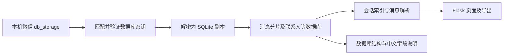

# 聊天记录如何获取，以及数据库结构浏览

## 获取链路

项目从 Windows 微信的本地数据库获取记录。主流程是：发现账号目录 → 取得数据库密钥 → 解密数据库副本 → 建立辅助索引 → 查询消息与媒体 → 通过 Flask 接口显示或导出。这里没有调用腾讯提供的聊天记录查询接口；日常浏览读取本地备份，内容更新需要重新备份。

1. **发现账号和源数据库。** `engine.utils.find_all_wechat_data_dirs` 检测 `xwechat_files/<账号>/db_storage` 等路径。网页 `/api/backup/run` 调用 `backup.pipeline.run_backup`，按扫描、解密、媒体迁移、索引四个阶段执行。
2. **取得并校验密钥。** `key_scan.run_key_scan` 优先复用已有配置，再依次尝试 MMKV 配置、微信 4.1.10+ 的 WCDB `Config.Cipher` 只读内存扫描、API Hook、传统内存扫描等回退方式。代码确实包含 Hook 回退，但用途是取得密钥，聊天浏览仍走离线副本。`backup.decryptor._resolve_key` 优先按数据库首页 salt 匹配，辅以文件名与 HMAC 验证，避免不同账号同名库用错密钥。
3. **解密副本。** `engine.decrypt.decrypt_database` 使用 SQLCipher 4 风格布局：4096 字节页、AES-256-CBC、80 字节保留区和首页 HMAC-SHA512 校验，写出普通 SQLite 数据库。之后验证 `sqlite_master` 是否可读。一键备份可按源文件指纹复用已有副本，并在独立输出目录迁移媒体文件。
4. **建立会话索引。** `backup.indexer.build_index` 扫描 `message_*.db` 的 `Msg_*` 表，把会话统计、精简消息元数据和联系人信息放入工具生成的 `data/chats.db`。它是辅助索引，不是微信原始表结构的全集。
5. **读取聊天消息。** `/api/messages` 调用 `engine.services.message.query_messages`。给定 `chat_id`，`_find_all_chat_dbs` 计算 `MD5(chat_id)`，在全部消息分片中定位 `Msg_<MD5>` 表，合并该会话跨分片的记录，筛选、排序并分页。消息查询主要读取 `local_id`、`local_type`、`origin_source`、`create_time`、`status`、`message_content`、`real_sender_id` 和 `packed_info_data`。
6. **解析显示内容。** `_row_to_message` 结合消息类型处理文本、Zstandard 压缩数据、XML 和媒体引用。发送者优先通过当前分片的 `Name2Id.rowid → user_name` 映射，再用联系人备注 / 昵称显示；`origin_source` 不能单独可靠地判断“本人发送”。媒体解析还会用到 `hardlink.db`、资源库和已迁移的图片 / 视频 / 语音文件。

主要代码入口：

| 用途 | 文件与函数 |
|------|------------|
| 备份调度 | `src/backup/pipeline.py:run_backup` |
| 网页采集入口 | `src/web/routes/backup_api.py:backup_run` / `backup_decrypt` |
| 密钥获取 | `src/key_scan.py:run_key_scan` |
| 新版只读密钥扫描 | `src/engine/services/config_cipher_extract.py:extract_keys_via_config_cipher` |
| 数据库解密 | `src/engine/decrypt.py:decrypt_database` |
| 备份数据库选择 | `src/backup/decryptor.py:decrypt_for_backup` |
| 会话索引 | `src/backup/indexer.py:build_index` |
| 会话列表 | `src/engine/services/chat.py:get_contacts` |
| 消息查询 / 解码 | `src/engine/services/message/__init__.py:query_messages` / `_row_to_message` |
| 发送者映射 | `src/engine/services/sender_model.py:load_name2id` |

## 新增的数据库结构页面

访问仪表盘 → **数据库结构**，或打开 `/schema`。

- 数据库下拉列表递归发现当前备份 / 解密目录中的 `.db`，同时列出源 `DB_DIR` 中尚未出现在解密目录的数据库。单个坏库不会妨碍浏览其他库。
- 选定数据库后列出全部实际表和视图，包括不被现有聊天解析器识别的表、SQLite 内部表和 FTS 辅助表。支持按表名或中文说明搜索。
- 表详情显示真实字段名、声明类型、主键序号、NOT NULL 声明、默认值、生成 / 隐藏列、原始建表 SQL、索引和外键；可继续搜索字段名及中文含义。NOT NULL 一栏显示显式声明，不能单独当作所有 SQLite 主键空值语义的结论。
- 结构通过 `sqlite_master` 及 SQLite PRAGMA 读取，不扫描聊天正文行。`data/` 下的辅助库会标为“工具生成”，以便识别。
- 网页“解密数据库”现在递归处理源目录全部 `.db`，保留相对目录；一键备份继续使用原有数据库白名单。缺少密钥的库会列为跳过，获取相应密钥后可再解密。

“所有表”指实际可访问数据库中存在的表；不同微信版本、账号和已解密范围会不同。仅知道加密库文件名无法读取其表结构，尚未解密的库会显示状态，不会虚构字段。

## 中文含义的依据

注释以代码内的小型映射和名称推测提供，不依赖联网模型，也不写回数据库。

| 标记 | 含义 | 例子 |
|------|------|------|
| 项目依据 | 项目现有解析代码已使用该表 / 字段，并标明来源；不是官方定义 | 消息表 `real_sender_id` 通过当前分片 `Name2Id` 映射发送者 |
| 名称推测 | 仅根据字段名解释，时间单位和枚举值等可能仍需确认 | 未识别表中的 `create_time` 推测为创建时间，单位待确认 |
| 未知 | 暂无足够依据，保留原名与类型 | 尚未识别的二进制字段 |

同名字段在不同表中不自动获得“项目依据”标记。例如任意未知表中的 `real_sender_id` 不会直接套用消息分片映射规则。新增已核实含义时，维护 `src/engine/services/schema.py` 中的上下文映射即可。

## 读取与验证边界

结构接口将数据库路径限制在当前解密目录内，以只读方式打开；静态快照在没有非空 WAL 时使用 SQLite `immutable` 模式，避免生成辅助文件。存在非空 WAL 时保留 WAL 感知读取，以免遗漏尚在 WAL 中的已提交结构；SQLite 此时可能维护共享内存 / WAL 辅助文件，但不会改写数据库内容。

全量解密在写入之前检查输出目录边界和文件身份，拒绝输出指向源库的硬链接或目录链接。结构显示使用文本节点，表名、字段名和 SQL 中的特殊字符不会作为 HTML 执行。

自动化测试覆盖元数据、索引 / 外键、标识符转义、未知字段、路径越界、异常文件、WAL 中已提交的结构、静态快照无辅助文件写入、全量解密额外数据库及源文件硬链接保护。网页用人工构造的演示库验证；真实微信版本和密钥提取能力仍以实际环境为准。
